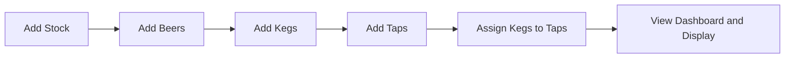

# BarTender Getting Started Guide

Last updated: 2026-11-08
Audience: first-time users

## Quick Setup

1. In Home Assistant, open Settings -> Add-ons -> Add-on Store.
2. Add repository URL: https://github.com/cjramseyer/BarTender
3. Install the BarTender add-on.
4. Start the add-on.
5. Open BarTender from the Home Assistant sidebar.

Optional standalone view:

- In the top-right Menu dropdown, click Open in New Window to launch the main app in its own browser tab/window while keeping ingress.

## First-Time Configuration

Open Settings in BarTender UI and set:

- Bar Name
- Owner Profile Name (Team Access)
- Bar Logo URL (optional)
- Keg Type Choices (keg/container sizes shown in Add Keg)
- Default Keg Type (optional)
- Measurement (us or metric)
- Theme (light or dark)
- Pro bar profile if you want Drinks, Add Classics, and Shopping List
- App-Only Stock Categories in General (categories excluded from public displays and menus)
- Printable Menu QR Mode (off, display, print, or both) in General
- Pour Mode in Pour Presets
- Default Pour Preset (used by dashboard and taps pour selectors)
- Team member PIN/disable settings in Team Access

Recommended defaults:

- Measurement: us (if using US keg sizes) or metric based on your inventory.
- Theme: use the one with best readability on your display device.

## First-Use Workflow

Use this order for a clean initial setup:

For a taproom, follow the beer/keg/tap steps below. For cocktails, use the [Pro drink workflow](#pro-drink-workflow); beer and keg records are not required for drink recipes.

1. Add bar stock items.
2. Add beers.
3. Add kegs.
4. Add taps.
5. Assign kegs to taps.
6. Verify display view.

### Step 1: Add Bar Stock

- Go to Bar Stock.
- Click Add Item.
- Enter name, category, quantity, unit, notes.
- Save.

Bar stock dialog note:

- Category and size fields include built-in suggestions.
- Standard sizes include 12 oz bottle, 16 oz bottle, and 12 oz can.
- Frequently used custom sizes are promoted into the main Size list.
- Keep bottles, mixers, garnishes, and other recipe ingredients in the same inventory. The dashboard no longer has a Bar Stock card; open Bar Stock from the navigation.
- Assign appropriate categories. Settings -> General -> App-Only Stock Categories excludes selected categories from displays and menus without hiding them in the management app or requiring per-item checkboxes.

### Step 2: Add Beers

- Go to Beers.
- Click New Beer.
- Enter beer details (name required).
- Save.

### Step 3: Add Kegs

- Go to Kegs.
- Click Add Keg.
- Enter keg details (name, selected beer, size, status, volume).
- Optional: add filled date and notes.
- Save.

Default behavior note:

- New kegs default status to empty unless you choose another status.
- New keg name is prefilled as Keg N based on existing keg names.
- Name and beer selection are required only when status is full.

### Step 4: Add Taps

- Go to Taps.
- Click Add Tap.
- Enter tap number and optional label/notes.
- Save.

Default behavior note:

- New tap label is prefilled as Tap N based on existing tap labels.

### Step 5: Assign Kegs to Taps

- Edit a tap and select Assigned Keg.
- Save.

Assignment behavior note:

- Kegs already connected to another tap are shown as in-use and cannot be selected.

Auto-fill behavior note:

- When a keg is connected to a tap and tapped date is empty, tapped date auto-fills.
- Existing tapped dates are preserved.

### Step 6: Verify Display

- Check dashboard and taps page for current assignment.
- Open display service if using a wallboard.

### Step 6b: Verify Standalone Window Launch

- In the top navigation, open Menu.
- Click Open in New Window.
- Confirm a new tab/window opens to the BarTender ingress route and renders without the embedded Home Assistant shell.

### Step 7: Verify Printable Menu

- Open Menu -> Options -> Printable Menu, or visit `/menu`.
- Confirm assigned taps, packaged beers, and public bottle/drink stock are visible. In a Pro profile, published cocktails and nonalcoholic recipes are also included.
- Verify garnishes and other app-only categories are excluded from public stock sections.
- If QR mode is enabled, verify the QR image loads.
- If QR is unavailable, install dependencies and restart runtime.

## Pro Drink Workflow

### Add Recipes

1. Select the Pro bar profile in Settings. Drinks and Shopping List are hidden and direct access is blocked for non-Pro profiles.
2. Open Drinks and choose **Add Classics** to import the 33 starter recipes, or **Add Drink** to create a custom recipe or use one starter.
3. Review measures, preparation steps, glassware, ice, garnish, substitutions, and allergens for your house specification. Existing recipes are never overwritten by Add Classics.
4. Select the corresponding bar-stock item for each ingredient. Only unique, exact name matches are linked automatically when importing classics.

Owners and managers can edit recipes and import classics; staff can read recipes and use the shopping list. Recipes remain in storage and backups if you switch away from Pro.

### Obtain Ingredients

1. Open **Menu -> Shopping List**. The list includes missing and out-of-stock ingredients from all saved recipes, including staff-only recipes.
2. Shop by drink section. Each ingredient appears only once, under the first alphabetical drink that needs it; other affected drinks are shown as references.
3. Select **Add to Bar Stock** for an item. The existing stock dialog opens with its name, quantity 1, and available details pre-filled. Recipe amounts are not used as bottle sizes.
4. Choose the category, size, and actual quantity, then save. New stock is linked to the affected ingredients; restocking updates the existing item instead of creating a duplicate. You return to the refreshed shopping list.
5. Use **Print List** for a paper copy. Optional ingredients are marked; items disappear from the list when their linked stock is replenished.

**Can Make Now** indicates stock on hand, not a guaranteed number of servings. Inventory quantities represent containers/items. Unknown quantities are not treated as known shortages, and viewing recipes or printing the list never deducts stock.

### Publish the Guest Menu

1. Edit a recipe and select **Publish on guest menu**; new classic imports are staff-only by default.
2. Add a menu description, optional price including currency, and applicable allergens.
3. Open the printable menu and verify the Cocktails and Nonalcoholic Drinks sections. Preparation steps, ingredient measures, and staff notes are not public.
4. Confirm Settings -> General -> App-Only Stock Categories hides recipe extras from the Bottles and Drinks section and display boards.

## Screenshots

These images use an isolated Pro demo with classic recipes and sample inventory; they do not contain an operator's bar data.

| View                      | Desktop                                                                | Mobile                                                               |
| ------------------------- | ---------------------------------------------------------------------- | -------------------------------------------------------------------- |
| Dashboard                 | [Desktop](assets/screenshots/sample-data/dashboard-desktop.png)        | [Mobile](assets/screenshots/sample-data/dashboard-mobile.png)        |
| Drinks                    | [Desktop](assets/screenshots/sample-data/drinks-desktop.png)           | [Mobile](assets/screenshots/sample-data/drinks-mobile.png)           |
| Shopping List             | [Desktop](assets/screenshots/sample-data/shopping-list-desktop.png)    | [Mobile](assets/screenshots/sample-data/shopping-list-mobile.png)    |
| App-Only Stock Categories | [Desktop](assets/screenshots/sample-data/stock-categories-desktop.png) | [Mobile](assets/screenshots/sample-data/stock-categories-mobile.png) |
| Public Menu               | [Desktop](assets/screenshots/sample-data/menu-desktop.png)             | [Mobile](assets/screenshots/sample-data/menu-mobile.png)             |

## Common Pitfalls

- Using ingress-only URLs from external clients: mobile may not reach them directly.
- Forgetting to back up data before major changes.
- Entering freeform status values outside expected set.
- Selecting replace import mode accidentally when merge is desired.
- Importing malformed backups that fail schema validation.
- Looking for Drinks or Shopping List in a non-Pro profile.
- Assuming an ingredient is available without linking it to a stock item.
- Giving a garnish a public beverage category instead of an app-only category such as Garnish or Other.

## Backup and Upgrade Basics

Before upgrading:

1. Export JSON backup from /api/export/json.
2. Optionally export ZIP archive from /api/export/archive.
3. Store backup outside the HA host.

Export file naming note:

- Download filenames include UTC date stamps, for example bartender_export_2026-09-01.json.

After upgrading:

1. Start add-on.
2. Open dashboard and settings.
3. Validate taps, kegs, and stock counts.
4. Spot-check one record from each section.
5. For a Pro profile, verify recipe links, Shopping List, and published drinks. Check the app-only category selection in Settings.

Restore workflow:

1. Open Settings -> Import Data.
2. Select .json or .zip backup file.
3. Choose import mode:

- replace: overwrite all current data
- merge: upsert imported records by id

4. Review preview counts, confirm, and import.

## Quick API Smoke Test

Use API Reference page (/api-reference) from Settings or top navigation, or use an HTTP client:

- GET /api/settings
- GET /api/stock
- GET /api/beers
- GET /api/kegs
- GET /api/taps

In a Pro profile, also check `GET /api/drinks` and `GET /api/shopping-list`. Recipe creation/editing and `POST /api/drinks/classics` require an owner/manager session.

Expected:

- 200 responses with JSON arrays/objects.

## Troubleshooting and FAQ

See [troubleshooting and FAQ](troubleshooting-faq.md) for detailed troubleshooting and common questions.
